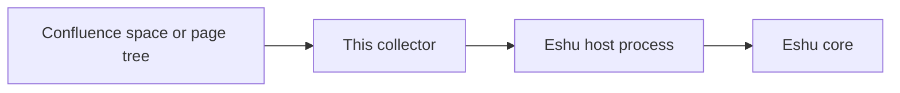

# eshu-collector-confluence

Status: pre-release. Do not rely on it in production yet.

This collector reads pages from one Confluence space (or one page tree) and hands Eshu a checked snapshot of that documentation.

Eshu is the core system. A collector is a small helper program: it reads one outside system, turns what it finds into facts (small, typed records), and gives those facts back to Eshu. This collector only reads Confluence. It never writes to Confluence.

## What it collects

One run (a claim, the job Eshu sends) reads one Confluence space or one root page tree as one snapshot. It returns 4 fact kinds that any documentation source can use, all with confidence `observed` (Eshu saw the source directly):

| Fact kind | Schema | One fact describes |
| --- | --- | --- |
| `documentation_source` | `1.0.0` | the space or page tree (one per claim) |
| `documentation_document` | `1.0.0` | one page |
| `documentation_section` | `1.1.0` | one page body |
| `documentation_link` | `1.0.0` | one link in a page body |

The same kinds come from Eshu's Git documentation path, so readers of the data do not change. Payloads use the published `sdk/go/factschema` encoders. Access stays cautious: Confluence page restrictions are not collected, so access is reported as `partial` and is never upgraded to allowed. Stored keys match the built-in collector byte for byte; the fact ID does not, because the host builds the final envelope (the wrapper Eshu stores). Recorded fixtures prove the match — see `testdata/README.md`, which also lists every deliberate difference.

Errors, statuses, and logs carry only a class, a status code, and counts. They never carry a token, web address, page ID, title, or page content.

## Result states and failure classes

Every claim ends in one state. A failure class is a short, fixed label that says what kind of problem happened, without leaking details.

| State | When | Failure class |
| --- | --- | --- |
| `complete` | every page was read and the page walk finished | none |
| `partial` | some pages were skipped (unreadable, over the page-size cap, or over the result cap), or the walk hit the page-count cap | none; `warning_count` counts the skips |
| `retryable` | rate limit (HTTP 429), server error (500/502/503/504), a temporary network error, or the claim ran out of time | `rate-limited`, `provider-unavailable`, `transport-error`, `claim-deadline-exceeded` |
| `terminal` | bad setup or credentials, login refused (HTTP 401), an unreadable space, or a response that cannot be read or is too large | `invalid-config`, `missing-credentials`, `auth-failed`, `permission-denied`, `invalid-response`, `response-too-large`, `connection-failed`, `untrusted-next-link`, `invalid-claim`, `unsupported_option` |

`retryable` means "try again later"; `terminal` means "stop until a person fixes something." The host owns the retry budget: it releases a retryable claim for another try until its attempt limit (10) is spent, then sets the work aside (dead-letters it) and keeps the last failure class. The collector sets no retry limit of its own. It never returns `unchanged`, because the host sends no earlier snapshot to compare with; instead the result carries a freshness hint (a digest of every fact returned), and Eshu skips storing a snapshot whose hint matches the current one. Each claim still reads the whole scope.

## How data flows



Text version: Confluence space or page tree → this collector → Eshu host process (checks and stores the result) → Eshu core. The collector never talks to Eshu's database directly and holds no database, graph, queue, or lease handle.

## When to use it, and when not to

Use it when Eshu needs the current pages, page bodies, and links from one Confluence space or page tree, refreshed on a schedule Eshu controls. Do not use it to edit Confluence, to read several spaces in one setup (use one setup per scope), or to judge who may see a page — restrictions are not collected, so access answers stay partial by design.

## How Eshu runs it

Eshu's component host starts this program for one claim at a time: it sends one bounded JSON request on standard input (stdin) and reads one result from standard output (stdout). The host builds the final envelope, checks the result, and owns claims and commits.

```bash
collector --sdk-stdio   # serve one claim from stdin (required flag)
```

The published image is `ghcr.io/eshu-hq/eshu-collector-confluence` (always `linux/amd64`, runs as user 65532, no shell). The binary can install itself into a component folder, which is how a startup (init) container sets it up:

```bash
collector seed --dest /component [--image-ref ghcr.io/eshu-hq/eshu-collector-confluence@sha256:<digest>]
```

This writes `/component/collector` (mode 0755) and `/component/manifest.yaml`. It leaves a file alone when the bytes and mode already match, so it is safe to run on every start, and it replaces a changed binary in one step. `--image-ref` (or `COLLECTOR_IMAGE_REF`) stamps the exact deployed image reference into the manifest, because an image cannot contain its own digest; the repository manifest keeps a placeholder digest. Anything that is not a plain `name@sha256:<64 hex>` reference is refused before any file is written. Installing still needs the 4 grants below and the `eshu-hq` publisher allowed, and `eshu component enable` is not repeat-safe, so setup must tolerate "already enabled."

## Configuration

Copy `config.example.yaml` and enable one scope per setup, for example: `eshu component enable dev.eshu.collector.confluence --instance confluence-eng --claims --config config.example.yaml`. The file has three parts: `host` names the job identity Eshu plans, `process` says how Eshu starts the binary, and `config` holds this collector's own settings. Unknown keys are rejected, so a typo cannot silently drop a limit. Never commit a real host, token, or user; the example uses reserved `.invalid` names on purpose.

| `config` key | Meaning |
| --- | --- |
| `source.base_url` | Confluence web address, for example `https://confluence.example.invalid/wiki` |
| `source.space_id` or `source.root_page_id` | Read one whole space, or one page tree from a root page. Exactly one is required |
| `source.space_key` | Optional label used in page-tree mode |
| `source.page_limit` | Pages per request, 1–250 |
| `source.max_total_pages` | Most pages in one walk; hitting the cap is reported as `partial` |
| `credentials.*_env` | Names of environment variables that hold the login (see below) |
| `attestation.allow_empty_successor` | Leave `false`; `true` is refused for now (see Known limits) |
| `limits.*` | Time and size caps for one claim (see below) |

Set `host.scope.id` to the ID the built-in collector used (`doc-source:confluence:<lower-case host>:<space id>`; in page-tree mode it carries the space ID of the first page read), so stored documentation continues under the same identity after a switch.

## Credentials

Secrets never go in the config file. Under `config.credentials`, name the environment variables the worker already has: `email_env` plus `api_token_env` for a Cloud API token, or `bearer_token_env` on its own. Defaults are `ESHU_CONFLUENCE_EMAIL`, `ESHU_CONFLUENCE_API_TOKEN`, and `ESHU_CONFLUENCE_BEARER_TOKEN`. If a bearer token is set, it wins over email-plus-token login. Secret values never appear in facts, logs, or status messages. Bad setup and missing credentials (`invalid-config`, `missing-credentials`) are refused before any request to Confluence.

## Time and size limits

The time bound for one claim is the smaller of `limits.claim_timeout_seconds` (default 300) and the time the host allows. The host sets the deadline to the first lease expiry and stops the process there; the default lease is 60 seconds (`ESHU_COMPONENT_COLLECTOR_CLAIM_LEASE_TTL` on the worker) and heartbeat messages do not extend it — so a timeout above the lease has no effect. The collector stops starting work shortly before the deadline (5% of the time left, at most 2 seconds) and returns `retryable` with `claim-deadline-exceeded` instead of being stopped mid-write. For any space that takes over a minute to read, set the worker lease to at least 5 minutes.

Other caps under `config.limits`: `fetch_concurrency` (page reads at once, 1–16), `max_page_bytes` (a larger page is skipped and the snapshot is `partial`), `max_result_bytes` (whole result), and `max_response_bytes` (one response). The host reads at most `process.stdout_limit_bytes` per claim (4 MiB by default): raise it for a large space and keep `max_result_bytes` below it. Pages that do not fit are left out whole, never cut in half.

## What operators see

The host keeps the collector's standard-error (stderr) text only as a byte count, so the useful signal is the status row in each result:

| Result | Fields operators get |
| --- | --- |
| `complete` or `partial` | `fact_count`, `source_latency_ms`, and for partial runs `partial` plus `warning_count` |
| `retryable` or `terminal` | `failure_class`, `retry_after_seconds` (retryable only), and `source_latency_ms` |

On current Eshu `main`, the worker also records each result as `eshu_dp_component_extension_*` metrics and one `component extension result` log line, and it honors `retry_after_seconds` (capped at one hour, never below the poll interval). Until a release carries that recording, only the failure class reaches the work item. The binary also writes `collector health` and `collector detail` debug lines to stderr for local runs (request counts and the exact config problem); the host does not surface them. This collector emits no metrics or traces of its own: the manifest declares the prefix `eshu_dp_confluence_collector_`, but nothing emits under it.

Before switching a live space to this collector, check two things. First, measure the largest space's read time (the status row's `source_latency_ms`, or time a local run) and make sure it fits inside the worker lease. Second, check a few stored page addresses (`canonical_uri`) against the live site: this collector joins the base address and page path so Cloud pages keep their `/wiki` prefix, which the built-in collector dropped, so the first claim after a switch stores a fresh snapshot. The live-site check is still open work; do not rely on those addresses until you have compared them.

## Permission to publish facts

All 4 fact kinds belong to Eshu core, so core must grant each kind (written permission to publish it) before the component installs. Grants are tied to the collector kind (`documentation`), not to one space, so one grant set covers every setup. `grant.example.json` lists the 4 grants; record each with `eshu component grant dev.eshu.collector.confluence --version 0.1.0 --kind <kind> --schema-version <v> --scope documentation --expires-in <duration>`.

## Known limits

- An empty or much smaller snapshot cannot yet replace the current one on request. Setting `attestation.allow_empty_successor: true` ends the claim as `terminal` with `unsupported_option`, before any Confluence request, because the published SDK cannot carry that promise yet. With the setting off, Eshu's safety check refuses such a snapshot, as it does for any collector. This lifts when an SDK release carries the needed field.
- `eshu component inspect` and `verify` judge this manifest once the 4 grants are recorded. `eshu component conform` still refuses these core kinds in the published SDK harness, even with grants; tests in this repo (`TestFixturesPassTheHostChecks`) run the same checks the host runs when facts are emitted.
- No metrics or traces are emitted by this process (see above). Two helper folders (`internal/stableid`, `internal/httpx`) copy built-in helpers a standalone repo cannot import yet; they will be replaced when the shared SDK helpers are published.

## Eshu dependencies

Exact versions from `go.mod`. Do not substitute another SDK line.

| Module | Version |
| --- | --- |
| Go | `1.26.10` |
| `github.com/eshu-hq/eshu/sdk/go/collector` | `v0.2.0` |
| `github.com/eshu-hq/eshu/sdk/go/factschema` | `v0.2.0` |
| `golang.org/x/net` | `v0.62.0` |
| `gopkg.in/yaml.v3` | `v3.0.1` |

The component ID is `dev.eshu.collector.confluence`, version `0.1.0`. It declares support for Eshu core `>=0.0.5 <0.2.0`, speaks `collector-sdk/v1alpha1` over the process adapter, and uses collector kind `documentation` (see `manifest.yaml`).

## What it never does

- It never writes to Confluence, and it never stores anything itself — the host validates and commits.
- It never imports Eshu core internals or another collector; `boundary_test.go` fails the build if that changes. It uses only the published SDK modules, the standard library, `golang.org/x/net/html`, and YAML parsing.
- It never puts tokens, page titles, page IDs, or page content into errors, logs, or status messages, and it never upgrades unknown page access to allowed.

## Build, test, and release

```bash
go build ./... && go vet ./...
go test -race -count=1 ./...
make ci   # lint + test + race; the full local check CI runs
```

Tests use local test servers and recorded fixtures only; no test reaches a real Confluence site. Saved check files in `testdata/conformance/*.json` are generated; refresh them with `UPDATE_CONFORMANCE_FIXTURES=1 go test -run TestConformanceFixturesAreCurrent .`.

Releases run from `.github/workflows/release.yml` on every push to `main` and on `v*` tags. Each run re-runs vet and race tests, builds the `linux/amd64` image, writes the digest to the job summary, signs it with cosign (keyless), and attaches provenance and SBOM attestations. A `main` push publishes the moving `main`, `latest`, and `sha-<full-sha>` tags; a version tag publishes that tag instead, and only if the tag is on the `main` head and matches `metadata.version` in `manifest.yaml` (an optional pre-release suffix such as `v0.1.0-rc1` is allowed). Nothing is published for a pull request, and the workflow deploys nothing. Before the first tag, also limit `v*` tag creation to maintainers.

After a release: make the GHCR package public once (GitHub creates it as private), confirm an anonymous pull works (`docker manifest inspect ghcr.io/eshu-hq/eshu-collector-confluence@sha256:<digest>` from a shell that is not logged in), copy the digest reference from the job summary into the deployment's `seed.image`, and verify before use:

```bash
cosign verify ghcr.io/eshu-hq/eshu-collector-confluence@sha256:<digest> --certificate-identity https://github.com/eshu-hq/eshu-collector-confluence/.github/workflows/release.yml@refs/tags/v0.1.0 --certificate-oidc-issuer https://token.actions.githubusercontent.com
gh attestation verify oci://ghcr.io/eshu-hq/eshu-collector-confluence@sha256:<digest> -R eshu-hq/eshu-collector-confluence
```

## Docs and related projects

- `config.example.yaml` — full setup example; `manifest.yaml` — identity, fact list, and core range; `grant.example.json` — the 4 grant requests; `testdata/README.md` — fixture and parity notes.
- [Eshu core](https://github.com/eshu-hq/eshu) — the host that runs this collector.
- [eshu-sdk](https://github.com/eshu-hq/eshu-sdk) — shared SDK modules. [eshu-deploy](https://github.com/eshu-hq/eshu-deploy) — deployment examples and reference setups.

## Contributing

See `CONTRIBUTING.md`. In short: `make ci` is the full local check (lint, test, and race with a 90% coverage floor); run it before pushing.

## License

MIT. See `LICENSE`.
