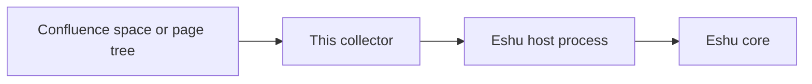

# eshu-collector-confluence

Status: pre-release. Please don't rely on it in production yet.

In a nutshell: this program reads pages from one Confluence space (or
one page tree) and hands Eshu a checked snapshot of that
documentation. Eshu is the core system, and a collector is a small
helper that reads one outside system and turns what it finds into
facts, which are small typed records. This one only reads Confluence.
It never writes there.

Text version: Confluence space or page tree, then this collector, then
the Eshu host process (it checks and stores the result), then Eshu
core. The collector never talks to Eshu's database directly, and it
holds no database, graph, queue, or lease handle.

## When it fits, and when it doesn't

Use it when Eshu needs the current pages, page bodies, and links from
one Confluence space or page tree, refreshed on a schedule Eshu
controls.

Don't use it to edit Confluence, to read several spaces from one setup
(one setup per scope works better), or to judge who may see a page.
Restrictions aren't collected, so access answers stay partial by
design, and no amount of config changes that.

## How Eshu runs it

Eshu's component host starts the program for one claim (one job) at a time.
It sends one bounded JSON request on stdin and reads one result from
stdout: `collector --sdk-stdio` (that flag is required).
The host builds the final envelope, checks the result, and owns claims
and commits, so the collector stores nothing itself.

## Documentation

| Page | What's in it |
| --- | --- |
| [Documentation](docs/README.md) | Start here: the whole docs tree in one index |
| [Getting started](docs/getting-started/README.md) | The fastest honest path to a first successful claim |
| [Concepts](docs/concepts/README.md) | What it does, the facts story, identity and grants, and what it never does |
| [Configuration](docs/reference/configuration.md) | Every setting, credentials, limits, and identity on a switch |
| [Facts](docs/reference/facts.md) | The fact kinds, schemas, and confidence, mirroring the manifest |
| [Guides](docs/guides/README.md) | Seed and enable, operate, troubleshoot, release |
| [Diagrams](docs/diagrams/README.md) | Every diagram, each with a text version |
| [Example config](config.example.yaml) | One activation for one scope, ready to copy |
| [Manifest](manifest.yaml) | Component identity, fact list, and the core version range |
| [Grant requests](grant.example.json) | The four producer grants this component asks core for |
| [Fixture notes](testdata/README.md) | How parity with the built-in collector is proved, and every deliberate difference |
| [Contributing](CONTRIBUTING.md) | The local check to run before you push |

## Related repos

Neighbours, not extra build dependencies. The SDK this build uses is
`github.com/eshu-hq/eshu/sdk/go/collector` and
`github.com/eshu-hq/eshu/sdk/go/factschema`, both at `v0.2.0` in
`go.mod`, and those modules live in the Eshu core repo, not in
`eshu-sdk`. Please don't swap in a different SDK line; the exact pins
are in [configuration](docs/reference/configuration.md).

- [Eshu core](https://github.com/eshu-hq/eshu) runs this collector and
  holds the SDK modules above.
- [eshu-deploy](https://github.com/eshu-hq/eshu-deploy) is related
  reading for deployment examples only. Nothing in this repo depends
  on it, and `rg eshu-deploy` outside this README comes back empty.

## Development

`make ci` runs lint, tests, and the race suite with a 90% coverage
floor, which is the full local check CI runs.

## Contributing, security, and license

See [CONTRIBUTING.md](CONTRIBUTING.md) for the details. There's no
separate security policy file yet, so if you spot a vulnerability or a
way for page content or tokens to leak into logs, please tell the
maintainers privately rather than opening a public issue. MIT license,
in [LICENSE](LICENSE).
