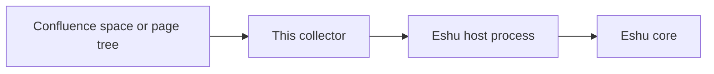
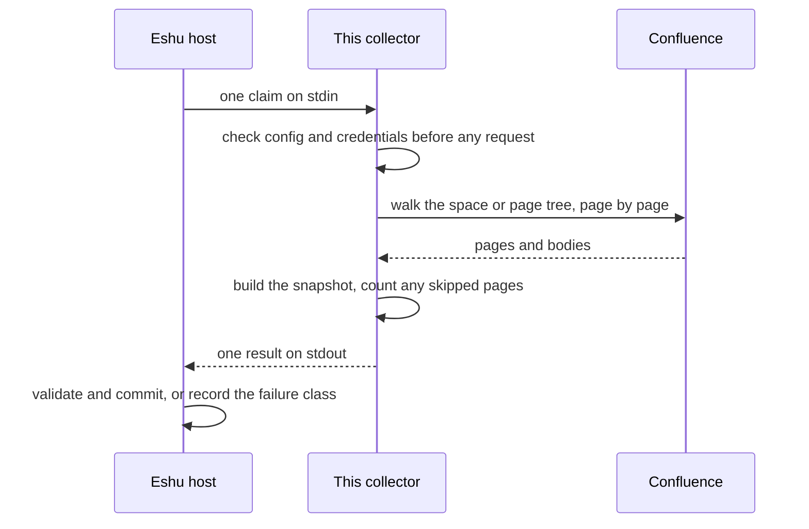

# Diagrams

Every diagram for this collector lives on this page, so there's one
place to keep them honest. Other pages link here instead of copying
the picture.

## System context

How a source system, this collector, the Eshu host, and Eshu core
fit together. The collector only talks to its source and to the
host over stdin/stdout.

Text version: Confluence space or page tree, then this collector, then
the Eshu host process (checks and stores the result), then Eshu core.

## Claim lifecycle

What happens to one claim, from the host sending it on stdin to the
host committing the result or recording a failure class. The
collector checks config and credentials before any provider call.

Text version: the host sends a claim, the collector refuses bad config
or missing credentials before it touches Confluence, walks the whole
scope, builds one snapshot, and returns it. The host validates and
commits, or records the failure. Each claim still reads the whole
scope, even if nothing changed; the result carries a freshness hint (a
digest of every fact returned) and Eshu skips storing a snapshot whose
hint matches the current one. It never returns `unchanged`, because
the host sends no earlier snapshot to compare with.
